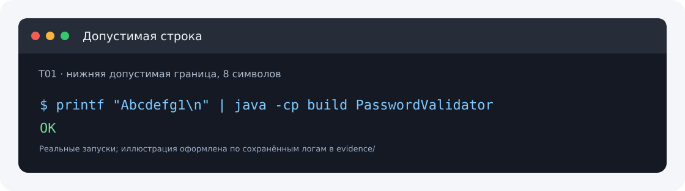
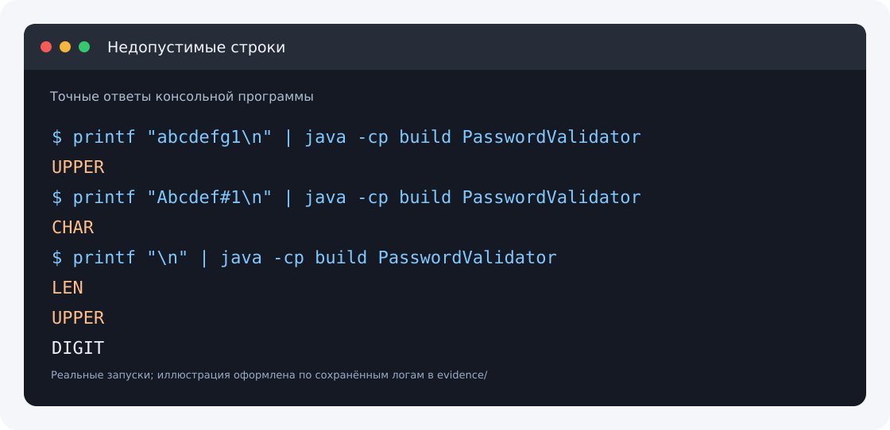
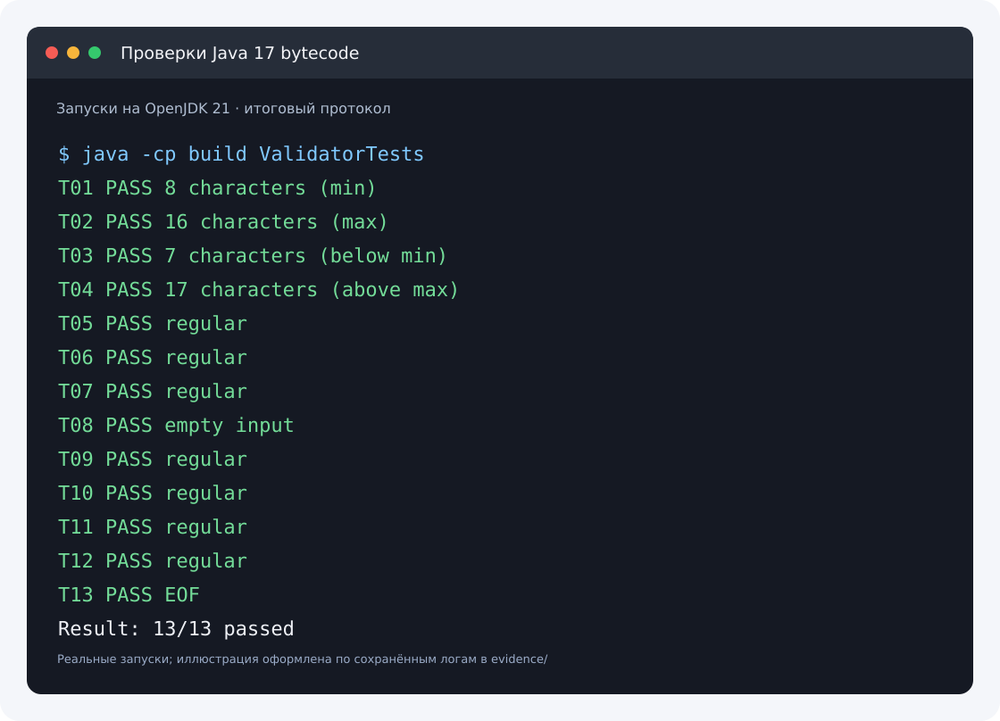
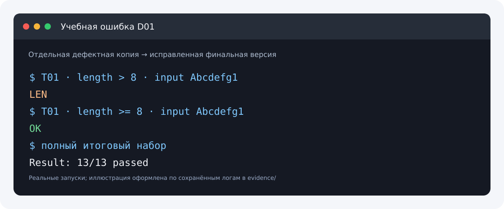

# Password Validator — итоговый проект Skillfactory

Консольная учебная программа на Java 17. Проверяет одну вымышленную строку: длину 8–16, наличие заглавной латинской буквы, цифры и отсутствие посторонних символов. Выводит `OK` или коды `LEN`, `UPPER`, `DIGIT`, `CHAR` в указанном порядке.

## Компиляция и запуск
```sh
javac --release 17 -encoding UTF-8 -d build src/PasswordValidator.java tests/ValidatorTests.java
java -cp build PasswordValidator
java -cp build ValidatorTests
```
Тестовый класс сохраняет фактические результаты 13 сценариев в `evidence/final/`.

## Материалы
- `src/` — программа; `tests/` — проверочный код отдельно.
- `docs/requirements.md` — требования R01–R10 и критерии завершения.
- `docs/process.md` — шаги A–F, контрольные точки.
- `docs/journal.md` — записи только фактически отправленных запросов.
- `prompts/` — запрос Q01 и шаблоны, явно помеченные `NOT_SENT`.
- `evidence/` — сохранённые запуски и разбор учебного дефекта.
- `docs/acceptance.md` — решение и ограничения.

**Объём исходника:** 56 непустых некомментированных строк. Компиляция в формат Java 17 подтверждена `--release 17`; фактические запуски в текущей среде — на OpenJDK 21 (см. evidence/compile.txt).

**Важно для сдачи:** аудит схемы в отдельном чате ещё не проводился. Подготовленный, но не отправленный промпт не является свидетельством выполненного задания. Нельзя выдавать его за фактический запрос.

**Учебный проект:** реальные пароли и другие чувствительные данные не используйте.

## Демонстрация работы

Иллюстрации сформированы из **фактического вывода** выполненных консольных команд. Они не изображают несуществующий графический интерфейс.

**Корректный ввод**



**Ошибки**



**Проверки**



**Учебный дефект и исправление**



GitHub Actions использует настоящий JDK 17. Статус сборки следует проверять на вкладке Actions; наличие workflow само по себе не подтверждает успешный прогон.

**Проверка непосредственно на Java 17:** [GitHub Actions — 13/13, успешно](https://github.com/ariverix/prmt-final-project-skf/actions/runs/44902513986). Локальная среда проверки — OpenJDK 21; оба прогона сохранены как отдельные свидетельства.
