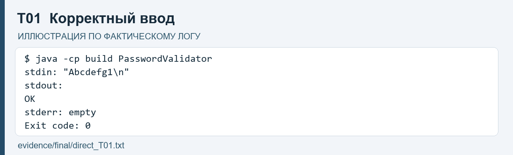
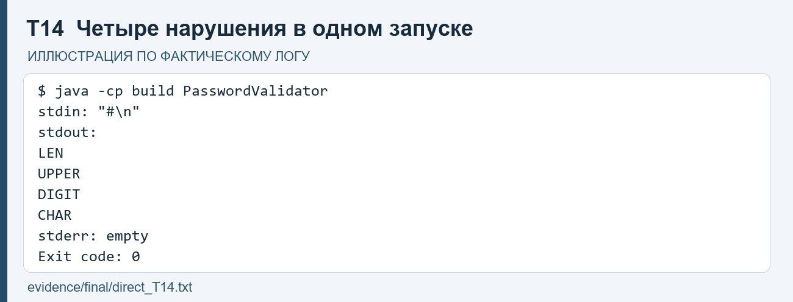

# Консольный валидатор пароля

Итоговый проект Skillfactory по дисциплине «Промпт-инжиниринг для разработчиков». Java 17, стандартная библиотека. Программа читает первую строку stdin и выводит `OK` либо коды нарушений в порядке `LEN`, `UPPER`, `DIGIT`, `CHAR`. Демонстрационные строки вымышлены.

## Сборка и запуск

Из корня проекта с JDK 17 в PATH:

```sh
javac --release 17 -encoding UTF-8 -d build src/PasswordValidator.java tests/ValidatorTests.java
java -cp build PasswordValidator
java -cp build ValidatorTests
```

При интерактивном запуске введите `Abcdefg1` и нажмите Enter. Ответ — `OK`. При вводе `#` будут выведены четыре кода. Тесты выполняют 14 отдельных запусков и пишут фактические результаты в `evidence/final/`.

## Проверка результата

**14/14 на JDK 17**, включая длину 7/8/16/17, пробелы, пустую строку, EOF, игнорирование второй строки и точный порядок всех четырёх ошибок. В программе 56 непустых строк без комментариев. [GitHub Actions](https://github.com/ariverix/prmt-final-project-skf/actions/runs/44907573229) · [лог Java 17](evidence/ci/java17_final_run.txt).

| Материал | Где находится |
| --- | --- |
| Требования и матрица | [R01–R10](docs/requirements.md) · [Матрица](docs/matrix.md) · [Шкала Skillfactory](docs/skillfactory_matrix.md) |
| Набор проверок | [T01–T14 и V01/V02](tests/scenarios.md) · [Фактические результаты](evidence/final/results.tsv) |
| Схема и аудит | [P2](docs/process.md) · [Пакет передачи](docs/handoff.md) · [Аудит](evidence/audit/Q02_response.md) · [Решения](evidence/audit/decisions.md) |
| Промпты и журнал | [Журнал](docs/journal.md) · [Промпты](prompts/) |
| Учебный сбой D01 | [Карточка и логи до/после](evidence/study_failure/card.md) |
| Приёмка | [Акт](docs/acceptance.md) · [Ограничения и сдача](docs/limitations.md) |

## Демонстрация





[Все изображения и первичные логи](assets/README.md).

## Комплект для сдачи

[Отчёт DOCX](https://github.com/ariverix/prmt-final-project-skf/blob/main/submission/Отчет_Итоговый_проект.docx) · [Отчёт PDF](https://github.com/ariverix/prmt-final-project-skf/blob/main/submission/Отчет_Итоговый_проект.pdf) · [ZIP](https://github.com/ariverix/prmt-final-project-skf/blob/main/submission/Skillfactory_Prompt_Engineering_Final.zip).
